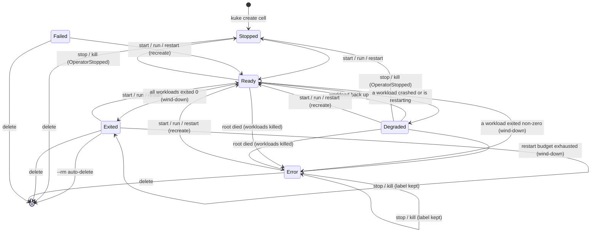

# Cell

A **cell** is a pod-like unit: a group of containers that share a network namespace. Exactly one container in each cell is the **root container** — it owns the network namespace, and every other container in the cell joins it.

If you've worked with Kubernetes pods, the mental model is the same: a `pause`-like container holds the network namespace. By default the daemon builds that root itself, a kukepause container. You can instead mark one of your own containers as the root with `root: true`.

## What a cell is

Creating a cell materializes:

1. **A cgroup subtree** — `/sys/fs/cgroup/kukeon/<realm>/<space>/<stack>/<cell>` — parent of every container in the cell.
2. **A Linux network namespace**, entered by the root container and shared by the rest.
3. **A veth pair** between the cell's network namespace and the space's bridge, configured by the CNI bridge plugin and `host-local` IPAM.
4. **Metadata** at `/opt/kukeon/<realm>/<space>/<stack>/<cell>/cell.yaml`.

## What runs in a cell

A cell is a workload boundary. An agent is one thing that runs in a cell; it is not what a cell is. Cells that exist today:

- a team agent cell: a harness container running an agent CLI (see [Teams](team.md));
- the pipeline reactor: a `script` harness cell that runs a program with no model (see [Teams → Program roles](team.md#program-roles-the-script-harness));
- kukeond itself: the `kukeond` cell in the `kuke-system` realm (see [System realm](system-realm.md));
- a GitHub Actions runner.

```text
Cell: github-runner
└── Container: runner

Cell: kukeon-dev-claude
└── Container: work
```

Each of these cells also has its [root container](#the-root-container).

## Cell spec

```yaml
apiVersion: v1beta1
kind: Cell
metadata:
  name: web
spec:
  id: web
  realmId: main
  spaceId: default
  stackId: default
  containers:
    - id: nginx
      image: docker.io/library/nginx:alpine
      root: true # owns the network namespace
    - id: sidecar
      image: docker.io/library/busybox:latest
      command: /bin/sh
      args: ["-c", "while true; do date; sleep 5; done"]
```

See [Manifest Reference → Cell](../manifests/cell.md) for the full schema.

## Identity, lineage, and provenance

A cell's **identity is its own document** — the `CellDoc`. The CellDoc owns the cell's `metadata.name`, its `spec` (containers, scope, volumes, …), and its `status`. Nothing outside the cell owns its name: a cell materialized from a [`CellBlueprint`](../manifests/blueprint.md) or [`CellConfig`](../manifests/config.md) gets a fresh `<prefix>-<6hex>` name (or a `--name`-pinned one), and the binding it came from is recorded as **lineage**, not identity.

- **Lineage labels.** A cell stamped from a binding carries a back-reference label — `kukeon.io/config=<name>` for a Config-lineage cell, `kukeon.io/blueprint=<name>` for a Blueprint-lineage one. These are 1:N back-references (a binding stamps N cells), used to list a binding's cells (`kuke get cells -l kukeon.io/config=<name>`) and to drive the daemon's OutOfSync reconcile — not to pin a singleton.
- **Materialization provenance.** Each stamped cell also persists a `Spec.Provenance` block — the binding kind, its scoped ref, the resolved params, and any per-cell `--env` and [`--connector`](connectors.md#per-cell-overrides) overrides — so [`kuke restart <cell>`](../cli/kuke-restart.md) can re-resolve the cell from its binding without re-supplying values.
- **Clone provenance.** A cell forked with [`kuke run --clone <cell>`](../cli/kuke-run.md) / `kuke create cell --clone <cell>` carries the `kukeon.io/source-cell=<name>` annotation recording the cell it was forked from. Unlike the lineage labels it is **inert** debug/grooming metadata: no reconcile or selector path keys off it, and it pins no identity. The clone keeps the source's lineage label and provenance binding, so it re-resolves against the same Blueprint/Config the source did.

## The root container

- One container in a cell is the root. If no container is marked `root: true` and `spec.rootContainerId` is unset, the daemon builds a default kukepause root (`docker.io/library/busybox:latest` with the `kukepause` binary bind-mounted in). It never picks one of your containers.
- A root you mark yourself starts before the CNI network attach, so it has no network at startup and must be a long-lived process. See [Manifest Reference → Container → Root container](../manifests/container.md#root-container).
- The root container is created first. Its network namespace is the cell's network namespace.
- Non-root containers join the same network namespace at creation time.
- The root anchors the cell: workloads join its network, IPC and UTS namespaces, kukeon reaches the cell's network through the root's PID, and the cell's CNI/IPAM lease is keyed to the root container. It must stay alive for as long as any workload runs.
- When every workload has finished, the reconciler stops the root (see [Lifecycle](#lifecycle)), whatever the workloads' `restartPolicy`.
- When the root container exits while a workload is still running, the reconciler kills the remaining workloads, releases the cell's network, and settles the cell in `Error` with reason `RootContainerExited`. Cells with only a root container (kukeond-style) are different: there the root is the workload, and the cell's state follows the root.

## Cell networking

- One IP per cell, not per container. All containers in the cell share the network namespace and therefore share the IP.
- `localhost` in any container reaches every port bound by every container in the same cell.
- The cell's IP is assigned by the space's CNI configuration (by default, from the bridge plugin's host-local range).
- Two cells in the same space can reach each other at the IP layer; two cells in different spaces cannot (unless you join them into a shared network).

## Lifecycle

### States

| State      | What it means                                                                                                                                                                                                                                                                                                                                                                                                                                      |
| ---------- | -------------------------------------------------------------------------------------------------------------------------------------------------------------------------------------------------------------------------------------------------------------------------------------------------------------------------------------------------------------------------------------------------------------------------------------------------- |
| `Pending`  | The cell's status was never written by a lifecycle path. `kuke create cell` stamps `Stopped`, so a cell is not normally seen in `Pending` today. `start`, `run <cell>` and `restart` refuse it; delete it and create it again.                                                                                                                                                                                                                     |
| `Ready`    | The workloads are running. For a root-only cell, the root is running.                                                                                                                                                                                                                                                                                                                                                                              |
| `Degraded` | Some workloads are running, but at least one is down in a non-clean way: it crashed, or it exited under a `restartPolicy` that wants it running and the reconciler is restarting it (or waiting out its backoff). Not sticky: the reconciler re-derives it every pass, so it returns to `Ready` when the workload recovers and settles to `Error` once an `on-failure` workload exhausts its retry cap.                                            |
| `Stopped`  | The operator stopped the cell (`kuke stop` / `kuke kill`), or `kuke create cell` materialized it without starting it. Only those paths set it; the reconciler never derives it. When an operator stop interrupts a cell that had not finished (a workload was running, the cell was `Degraded`, or a restart was owed), the cell also carries reason `OperatorStopped`, and the label is durable: the reconciler keeps it `Stopped` across passes. |
| `Exited`   | Every workload exited 0 on its own, and no restart is owed. Auto-delete-eligible: a `kuke run --rm` cell in this state is deleted.                                                                                                                                                                                                                                                                                                                 |
| `Error`    | A workload exited non-zero and no restart is owed (reason `WorkloadFailed`), or the root died under running workloads (reason `RootContainerExited`). `message` names the container and its exit code or signal. Sticky: the reconciler does not re-derive it, and it is never auto-deleted, so the failure stays inspectable. It is still restartable: `kuke start` / `run <cell>` / `restart` recreate the cell.                                 |
| `Failed`   | A kukeon bring-up fault: create, start or recreate failed. A crashed workload is `Error`, not `Failed`. Sticky like `Error`, and restartable the same way.                                                                                                                                                                                                                                                                                         |
| `Unknown`  | kukeon cannot tell (for example containerd is unreachable, or a workload's task status could not be read). The reconciler waits for the next pass rather than act on it.                                                                                                                                                                                                                                                                           |

### Exits, wind-down and root death

Each reconcile pass reads every container's task from containerd and applies these rules, in order:

1. **Sticky states are kept.** `Error` and `Failed` are not re-derived. An `Error` cell whose root is still running is wound down (see rule 5) and keeps its label.
2. **A durable `Stopped` is kept.** A never-started cell, or one carrying `OperatorStopped`, stays `Stopped` unless a workload is seen running again (a task started outside kukeon).
3. **Root death.** If the root is terminal while a workload is still running, the reconciler kills every workload, runs the CNI/IPAM cleanup, and sets `Error` with reason `RootContainerExited` in the same pass. An `Unknown` root read does not count. Root-only cells are exempt.
4. **Derivation and restarts.** For a cell with workloads, the state follows the workloads, not the root: `Ready` if they are all up, `Degraded` if some are up and one is down, `Exited` if all exited 0, `Error` if any exited non-zero. A root-only cell follows its root. A workload whose `restartPolicy` asks for a restart (`always` on any exit, `on-failure` on a non-zero exit) is restarted, subject to its backoff and retry cap; while a restart is owed the cell is held at `Degraded`. `restartPolicy` decides only whether a workload is restarted.
5. **Wind-down.** Once every workload is terminal and no restart is owed (derived `Exited` or `Error`), the reconciler stops the root within that pass, whatever the `restartPolicy`. The stop is graceful: SIGTERM, then SIGKILL after 5 seconds. A root that handles SIGTERM, such as the injected kukepause root, ends with exit 0; one that ignores it (for example `sleep infinity` as PID 1) ends with exit 137. Every container's task is deleted, so every container then reads `Stopped` with its last exit code preserved. The cell keeps its derived `Exited` / `Error` label and its `reason` / `message`; it never passes through `Stopped`. Container records and snapshots stay, so the cell can be started again.
6. **`--rm`.** A cell with `spec.autoDelete` (`kuke run --rm`) that settles `Exited` is killed and deleted instead of wound down. `Error`, `Failed` and `OperatorStopped` cells are never auto-deleted.

`kuke refresh` applies rules 1, 2 and 4 the same way but acts on nothing: it never restarts, winds down, tears down or deletes a cell.

### States and verbs

| State      | `start`                        | `stop` / `kill`                                           | `restart`          | `run <cell>`             | `delete`         |
| ---------- | ------------------------------ | --------------------------------------------------------- | ------------------ | ------------------------ | ---------------- |
| `Pending`  | refused                        | stops tasks; `Stopped`                                    | refused            | refused                  | removes the cell |
| `Ready`    | refused while a workload runs  | `Stopped` + `OperatorStopped`                             | stop, then start   | attaches                 | removes the cell |
| `Degraded` | recreates the cell             | `Stopped` + `OperatorStopped`                             | recreates the cell | recreates, then attaches | removes the cell |
| `Stopped`  | starts the existing containers | stays `Stopped`                                           | starts             | starts, then attaches    | removes the cell |
| `Exited`   | starts the existing containers | stays `Exited`; any leftover task is ended                | starts             | starts, then attaches    | removes the cell |
| `Error`    | recreates the cell             | stays `Error` with its reason; any leftover task is ended | recreates the cell | recreates, then attaches | removes the cell |
| `Failed`   | recreates the cell             | `Stopped`                                                 | recreates the cell | recreates, then attaches | removes the cell |
| `Unknown`  | refused                        | stops tasks; `Stopped`                                    | refused            | refused                  | removes the cell |

Notes on the table:

- `start`, `restart` and `run <cell>` share one decision in the daemon: `Pending` and `Unknown` are refused with a `kuke delete cell` pointer; `Failed`, `Error` and `Degraded` are recreated (stop, recreate the containers, start); `Stopped` and `Exited`, and a `Ready` cell whose tasks are gone, start from their existing container records. `restart` stops first only when the cell is `Ready`.
- `stop` and `kill` differ only in the first signal (SIGTERM, escalating to SIGKILL after the timeout, versus SIGKILL straight away). Either verb ends and deletes every task in the cell, including tasks that had already exited, and waits (bounded) for each one to exit. Afterwards every container reads `Stopped` with its last exit code (137 for a SIGKILLed task).
- The label after `stop` / `kill` is decided before anything is torn down. A `Ready` cell whose workload has already exited (for example `kuke run --rm` killing the cell after the workload finished) becomes plain `Stopped` without `OperatorStopped`, so the reconciler can still settle it to `Exited` and auto-delete it.
- `delete` stops any task still running and removes the cell's containers, snapshots, cgroup and metadata.

### State diagram



## Operations

```bash
# Materialise a cell from a daemon-stored CellBlueprint (containers declared in the Blueprint)
sudo kuke create cell mycell --from-blueprint web --realm main --space default --stack default

# Or apply a full cell manifest (preferred)
sudo kuke apply -f cell.yaml

# List cells
sudo kuke get cells --realm main --space default --stack default

# Start / stop / kill (positional — no `cell` subcommand)
sudo kuke start mycell --realm main --space default --stack default
sudo kuke stop  mycell --realm main --space default --stack default
sudo kuke kill  mycell --realm main --space default --stack default

# Delete (removes the cell and its materialised containers as a single unit)
sudo kuke delete cell mycell --realm main --space default --stack default
```

## Related concepts

- [Container](container.md) — what runs inside a cell
- [Stack](stack.md) — the parent of cells
- [Networking](networking.md) — how cell IPs and bridges work
